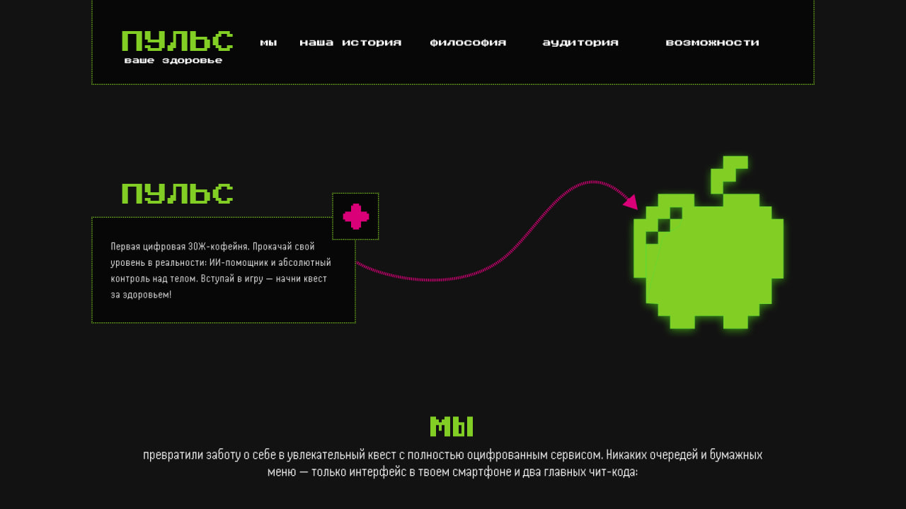

# ПУЛЬС

**Геймифицированная ЗОЖ-кофейня, превращающая скучную диету в азартный квест: выбор полезной еды в меню конвертируется в цифровую валюту, личный рейтинг и реальную пользу для здоровья.**

## Ссылка на сайт

https://ssskkmk.github.io/session/

## Скриншот

## Автор

Ростислав Мамонтов БРИЦП262

## Что я научился(ась) делать

- Получился рабочий сайт, сверстанный при помощи метода flex.
- Было трудно ровно повторить макет из фигмы при помощи кода. Возникла проблема с повтором векторный загнутых стрелок между блоками текста, с чем мне помог ИИ.
- Научился верстать сайты, правильно распределять файлы в репозитории.

## Использование ИИ

### Инструменты

| Инструмент | Для чего использовал(а)                                 | Уровень помощи |
| ---------- | ------------------------------------------------------- | -------------- |
| Gemini 4   | Для реализации векторных стрелок между блоками текста   | 3              |
| Gemini 4   | Переделать названия классов на более профессиональные   | 2-3            |

### Записи о запросах

#### Запись №1 · 29.10.2026

- **Что я хотел(а) сделать:** Реализовать векторные стрелки между блоками текста
- **Что я спросил(а):** Прикрепляю код и макет из фигмы, основываясь на макете, сделай векторные стрелки на тех же местах.
- **Что ответил ИИ:** Выполнил задачу
- **Что я изменил(а) сам(а):** Ничего, но разобрал код, постарался понять как это работает
- **Как я понял(а), что это работает:** Проверил, запустив код

#### Запись №2 · 29.10.2026

- **Что я хотел(а) сделать:** Переделать названия классов на более профессиональные
- **Что я спросил(а):** Переделай названия классов в моем проекте, поменяй странные названия переменных на профессиональные аббревиатуры, соответствующие содержанию класса
- **Что ответил ИИ:** Выполнил
- **Что я изменил(а) сам(а):** Изначально было сделано мной для красоты попросил переименовать классы на правильные названия
- **Как я понял(а), что это работает:** Проверил, ничего ли не сломалось

### Выводы

ИИ помог мне в реализации векторных стрелок и изменение названия классов. Он не ошибался. При помощи генеративной нейросети больше узнал о правильном нейминге.